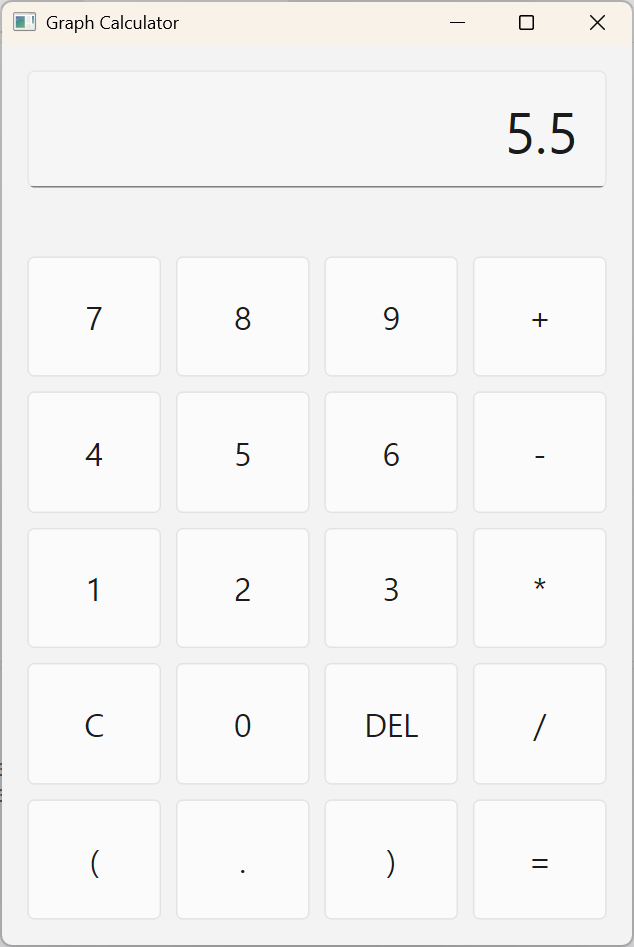

# Techspike C++

- `basics/`: Basic C++ exercises
- `graph-calculator/`: A GUI calculator built with C++17 and Qt 6

Supports arithmetic operations, decimals, negative numbers, parentheses, and operator precedence.
Use the mouse to enter expressions, **Enter** to calculate, **Backspace** to delete, and **Esc** to clear.

| Expression | Result |
| --- | --- |
|  |  |
